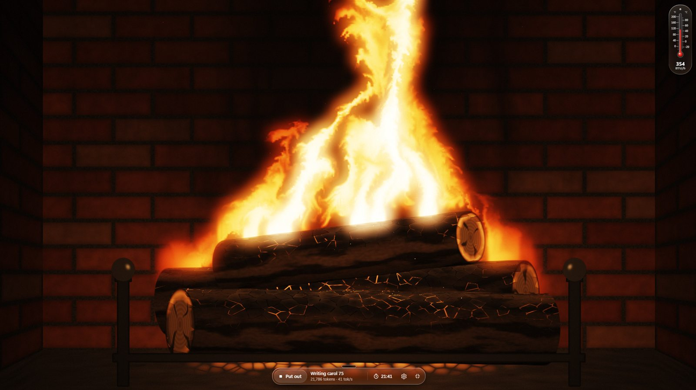
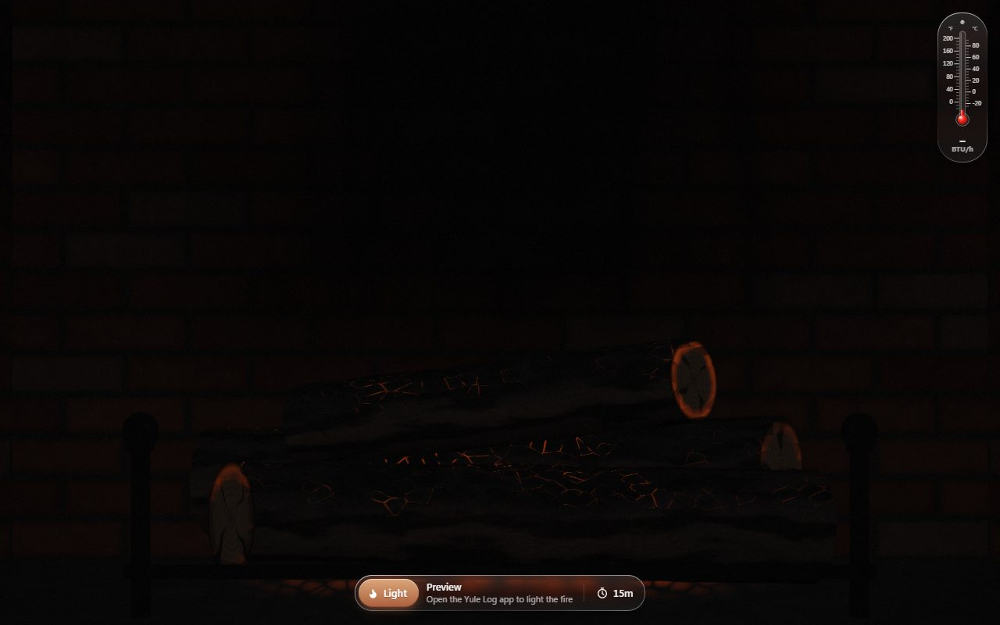

<div align="center">

# Yule Log

### Heat. Reimagined.

[](https://github.com/DUR6NA/yule-log/releases/latest)




<sub><i>Carol #75. 21,786 tokens. 354 BTU/h. Zero verses read.</i></sub>

</div>

---

Every once in a while, a revolutionary product comes along that changes everything.

Today, we're introducing three revolutionary products.

**A fireplace.** **A Christmas songwriter.** **And a space heater.**

A fireplace. A songwriter. A space heater. A fireplace. A songwriter. Are you getting it?

These are not three separate devices. This is *one app*.

And we are calling it **Yule Log**.

---

## The most advanced fire we've ever made.

Winter has reached the Midwest, and the furnace is a graphics card.

Yule Log turns a local AI model into firewood. It writes Christmas carols, one after another, forever,[^forever] and every token goes straight onto the fire.

Nobody reads the carols. Not you, not us, not even the app: each token is counted, thrown on the fire, and forgotten. The only evidence a carol ever existed is that the room is a little warmer.

We believe it's the most honest use of generative AI ever shipped.

## Token‑to‑Flame™.

```
   "Write a Wisconsin polka about a thermostat war"
                        │
                        ▼
                ┌──────────────┐  tokens  ┌──────────────────┐
                │  local model │ ───────▶ │ fluid simulation │ ───▶ fire
                └──────────────┘          └──────────────────┘
                        │ watts
                        ▼
                   thermometer
                (°F · °C · BTU/h)
```

At the heart of Yule Log is a real-time fluid simulation on your GPU: buoyant heat, vorticity confinement and a full pressure solve, licking at procedurally shaded logs. Every token throws a spark. While tokens flow, the fire roars. When they stop, it dies back to embers.

It's not a video loop. It's physics, powered by poetry nobody asked for.

## Thermometer. Now with actual temperature.

Other fireplaces show you a picture of warmth. Yule Log measures it.

The outdoor thermometer reads your real GPU through NVIDIA's driver. The column is GPU temperature in °F and °C, and the number underneath is heat output in BTU/h (watts × 3.412).[^watts] Without an NVIDIA card it stays blank and simply looks festive. We call that design.

## Embers. Pro.

<div align="center">

</div>

When the model goes quiet, the fire doesn't just stop. It settles: glowing cracks, lit end grain, a slow fade. The renderer drops from 60 fps to 20 so it sips your GPU instead of gulping it. We call it **EmberMotion**.

## Bring your own brain.

Yule Log doesn't come with a model and doesn't pick one for you. Run whatever you like locally with [LM Studio](https://lmstudio.ai), [Ollama](https://ollama.com), llama.cpp, Jan, vLLM, or anything else that speaks the OpenAI API, and connect Yule Log to it.

Whatever you run gets the same brief: Wisconsin polkas about thermostat wars, Motown numbers about lake-effect snow, barbershop-quartet tributes to tater tot hotdish. Fourteen musical styles, a whole pile of Midwestern subjects. Santa gets stuck in a snowdrift outside Fargo. The Packers play on Christmas Day.

Every carol is completely original. Every carol is completely unread.

## Tech Specs

| | **Yule Log** |
| --- | --- |
| **Fuel** | Tokens, from any OpenAI-compatible local model |
| **Model** | Yours. Not included. |
| **Heat output** | Your GPU's power draw × 3.412 BTU/h |
| **Carol length** | Up to 700 tokens |
| **Musical styles** | 14, from traditional church carol to Wisconsin polka |
| **Frame rate** | Up to 60 fps lit, 20 fps as embers |
| **Auto-off** | 15 minutes to 7 days, or Never |
| **Carols read** | 0 |
| **Weight** | 0 g. The lightest Yule log ever made. |
| **Chimney** | Not required |

## Get it.

Grab the latest from **[Releases](https://github.com/DUR6NA/yule-log/releases/latest)**.

| Platform | File | Notes |
| --- | --- | --- |
| 🪟 Windows 10/11 | `Yule-Log_x.y.z_x64-setup.exe` | Installs for the current user, no admin needed. It isn't code-signed, so SmartScreen may ask: **More info → Run anyway**. |
| 🍎 macOS (Apple Silicon + Intel) | `Yule-Log_x.y.z_universal.dmg` | Not notarized. If macOS calls it "damaged", run `xattr -cr "/Applications/Yule Log.app"` once. |
| 🐧 Debian / Ubuntu | `Yule-Log_x.y.z_amd64.deb` | `sudo apt install ./Yule-Log_*.deb` |
| 🎩 Fedora / openSUSE | `Yule-Log-x.y.z-1.x86_64.rpm` | `sudo dnf install ./Yule-Log-*.rpm` |
| 📦 Any other Linux | `Yule-Log_x.y.z_amd64.AppImage` | `chmod +x` it and double-click. |

Then:

1. **Run a model locally** in LM Studio, Ollama, llama.cpp, Jan, or any other OpenAI-compatible server, and start its server.
2. **Hit Light.** The first time, Settings opens: pick your server from the presets (or type its address), choose a model from its list, and save.
3. **Hit Light again.** Feel the warmth.

> **LM Studio tip:** leave Just-in-Time Model Loading on (its default). Yule Log loads your model the first time you light the fire, and LM Studio unloads it after 10 idle minutes.

## Using it

- **Light** starts the fire. **Put out** stops it immediately.
- **Auto-off** (the clock in the dock): 15m, 30m, 1h, 2h, Never, or a custom time like `45m`, `1h30`, `2:15` or `3d` (up to 7 days). When time runs out, the carol in progress gets up to 45 seconds to finish. Nobody likes a song cut off mid-chorus, even if nobody's listening.
- **Settings** (the gear): server address, model, and an API key if your server wants one. Changes apply from the next carol.
- **Full screen**: the button, **F**, or double-click the fire. **Esc** leaves.
- While the fire burns, the controls fade away. Move the mouse to bring them back.

## Fire safety

- **Auto-off is on by default.** Every fire gets a timer, 15 minutes unless you choose otherwise. Burning all night only happens if you pick **Never**, and then that's between you and your power company.
- **Closing the window puts the fire out**, and the dropped connection stops the model mid-carol.
- **Portion control.** Each carol is capped at 700 tokens, and models are asked to skip their hidden "thinking" and get straight to singing.
- **A polite houseguest.** The fire draws at most 60 fps, so it shares the GPU: about 52 tok/s with the fire on screen versus 60 without.[^bench]

## What people are saying

> "I haven't read a single carol. Best Christmas we've had in years."
> <br>— *Dad, Duluth*

> "It's beautiful. Who's paying for the electricity?"
> <br>— *Mom*

> "Mrrp."
> <br>— *The cat, asleep in front of the monitor*

## Contributing

Yule Log is a joke, but the fire is real, and pull requests are welcome. Some ideas:

- **More carols.** New musical styles and Midwestern subjects go in [`src-tauri/src/carols.rs`](src-tauri/src/carols.rs).
- **A thermometer for everyone.** It only reads NVIDIA cards today. AMD, Intel and Apple Silicon support would be lovely.
- **A better fire.** The simulation lives in [`src/fire.js`](src/fire.js). Make it prettier, cheaper, or both.
- **Testing on Linux and macOS.** Most of the burning so far has happened on Windows.

Please don't open an issue asking to read the carols.

### Building

You need Node 20+, Rust, and the [Tauri prerequisites](https://tauri.app/start/prerequisites/) for your platform.

```sh
npm install
npm run dev     # run it
npm run build   # build an installer for your platform
```

To work on the fire without a model, serve `src/` with any static file server and open `index.html?fire=0.9` (0 is embers, 1 is roaring).

- `src/` is the frontend, plain files with no bundler: `fire.js` (the simulation), `glass.js` (the liquid-glass refraction), `app.js` (everything else).
- `src-tauri/src/` is the Rust side: `engine.rs` runs the fire and talks to the model server, `settings.rs` stores the settings, `gpu.rs` reads the GPU, `carols.rs` has the prompts.
- The `LMSTUDIO_URL` and `MODEL` environment variables prefill the settings, handy while developing. On Windows, `scripts\dev-run.bat` is a shortcut for `npm run dev`.

---

<div align="center">

**Yule Log.** Designed in the Midwest. Assembled by your graphics card.

<sub>Yule Log is not a furnace, a smoke detector, or a substitute for either. No carols were read in the making of this app.</sub>

</div>

[^forever]: "Forever" means until the auto-off timer runs out, 15 minutes by default. **Never** is available for the brave.
[^watts]: Board power as reported by NVIDIA's driver, summed across your GPUs. Actual coziness depends on your room, your GPU, and your relationship with your power company.
[^bench]: Measured on an RTX 4060 Ti in November. Your tokens may vary.
